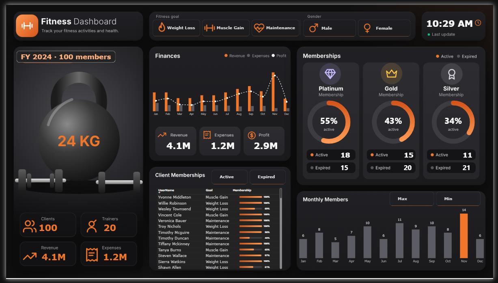
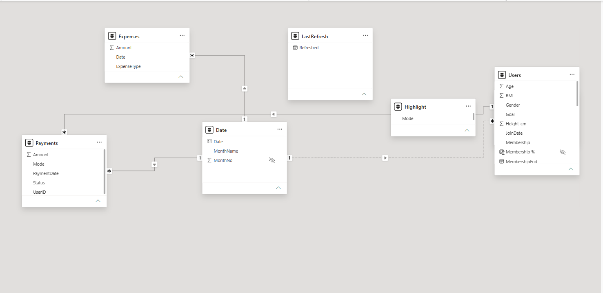

# 🏋️ Gym Fitness & Membership Dashboard · Power BI

A dark-themed, interactive Power BI dashboard for a gym's **members and finances**: membership tiers and retention, new sign-ups, revenue, expenses and profit, and members' fitness goals, gender and trainers. It covers FY 2024.

> **About the data:** this is a practice dataset with **fictional member names**. It is not real personal or health data. The project was built from a *Business Requirements of Fitness Dashboard* document and extended with my own DAX, data-model fixes and design.



---

## 🎯 Business questions

1. Is the gym profitable, and how do revenue and expenses move through the year?
2. When do new members join, and which months are strongest and weakest?
3. How well does each membership tier (Platinum, Gold, Silver) keep members active?
4. What are members' fitness goals, and how do they split by gender?

---

## 📂 Dataset

File: [`fitness-dataset.xlsx`](fitness-dataset.xlsx)

| Table | Rows | One row = |
|---|---|---|
| Users | 100 | One gym member: age, gender, goal, trainer, tier, start/end dates, status, height, weight, BMI |
| Payments | 100 | One membership payment: amount and mode (Cash / Card / Online) |
| Expenses | 90 | One expense: Salaries, Rent, Electricity, Maintenance, Miscellaneous |

**Tables built in Power BI:** `Date` (DAX: `CALENDAR` + `ADDCOLUMNS`), `LastRefresh` (for the "Last update" clock) and `Highlight` (the Max/Min toggle).

Members joined between Jan and Dec 2024. Active/Expired status reflects a snapshot taken around **1 Aug 2025**.

---

## 🛠️ Tools used


---

## 🔍 Approach

### 1. Data model



| Relationship | Type | Purpose |
|---|---|---|
| Date → Payments | One-to-many, single direction | Revenue by month |
| Date → Expenses | One-to-many, single direction | Expenses by month |
| Users → Payments | One-to-many, single direction | Revenue by member, tier, goal and gender |
| Date ⇢ Users (`JoinDate`) | One-to-many, **inactive** (dotted line) | Switched on only inside the *New Members* measure with `USERELATIONSHIP` |

- `Highlight` and `LastRefresh` are disconnected helper tables, used for the Max/Min toggle and the last-update clock.
- The Users → Payments link was originally a two-way 1:1 relationship, which made the model **ambiguous** once Date was linked to both tables. Making it single-direction and keeping the JoinDate link inactive resolved this (see *Challenges*).
- Helper columns such as `MonthNo` and `Membership %` are hidden from report view to keep the field list clean.

### 2. DAX
| Type | Items |
|---|---|
| Core measures | Total Clients · Total Trainers · Revenue · Expenses · Profit · Profit Margin % · Active Members · Expired Members · New Members · Last Update |
| Visual and design measures | Bar Colour (Max/Min highlight) · Tier Ring SVG · Ring Platinum / Gold / Silver · Membership Bar SVG · Badge Text · Profit Colour |
| Calculated columns | Membership % · Goal Order · Gender Order |
| Calculated tables | Date · LastRefresh |

### 3. Power Query
Light preparation: loaded the three sheets and checked data types. The source data was already clean.

### 4. Dashboard design
- **KPI cards:** Clients · Trainers · Revenue · Expenses · Profit
- **Finances:** line and clustered column chart of monthly revenue and expenses, with a profit line
- **Memberships:** three SVG rings showing % active per tier, with active/expired counts
- **Monthly Members:** new sign-ups by month, with a **Max/Min toggle** that highlights the peak or lowest month
- **Client Memberships table:** each member's goal and an **SVG progress bar** for how far through their membership they are
- **Icon button slicers:** Fitness goal (Weight Loss · Muscle Gain · Maintenance) and Gender (Male · Female)
- A dynamic **"FY 2024 · N members"** badge and a **last-update clock**
- A custom dark background designed outside Power BI, with styled Default, Hover and Selected button states

---

## 📊 Key findings

| Metric | Value |
|---|---|
| 👥 Clients | **100** |
| 🧑‍🏫 Trainers | **20** |
| 💰 Revenue | **4.09M** |
| 🧾 Expenses | **1.17M** |
| 📈 Profit | **2.92M** (71.3% margin) |
| ✅ Active / ❌ Expired | **44 / 56** |

- 💵 **Highly profitable:** 4.09M of revenue against 1.17M of expenses gives a **71% profit margin**. Salaries are the largest cost (about 0.77M, roughly two-thirds of expenses).
- 📅 **Sign-ups are seasonal:** new members peak in **November (14)** and are lowest in **March (5)**. July (11), May (10) and September (10) are also strong.
- 🏅 **Retention differs a lot by tier:** Platinum **55%** active (18/33), Gold **43%** (15/35), Silver only **34%** (11/32).
- 🔁 **Renewals are the biggest opportunity:** **56 of 100** memberships have expired.
- 🥇 **Gold drives revenue:** 35 members × 80,000 = **2.8M of the 4.09M** (68%).
- 🎯 **Goals:** Weight Loss is the most common goal (**39** members), followed by Muscle Gain (**37**) and Maintenance (**24**).

---

## 💡 Recommendations

*Based on this practice dataset.*

1. **Run a renewal campaign.** With 56% of memberships expired, contacting expired members (starting with Gold, the highest-value tier) is the fastest way to grow revenue without new acquisition costs.
2. **Fix Silver retention.** Only 34% of Silver members stay active. Exit feedback, or an upgrade offer into a longer tier, could show whether the short plan is the problem.
3. **Plan around the seasons.** Staff up and launch offers before the November peak, and use the March dip for referral or trial campaigns.
4. **Build programmes around goals.** Weight Loss and Muscle Gain cover 76% of members, so dedicated programmes and trainer specialisation there would serve most clients.
5. **Review tier pricing** (see *Limitations*).

---

## ⚠️ Limitations

- **Pricing looks inconsistent:** Gold (80,000) is priced higher than Platinum (10,000), even though Platinum memberships run about a year. This looks like a dataset issue, and in a real project I would confirm it with the business before drawing pricing conclusions.
- The dataset is small (100 members, one year), so trends are directional, not statistically robust.
- Active/Expired status is a fixed snapshot (about 1 Aug 2025), not live.

---

## 🧩 Challenges & what I learned

| Problem | What went wrong | Fix |
|---|---|---|
| **USERELATIONSHIP error** | *New Members* failed because there was no Date → JoinDate link. Adding one created an **ambiguous path**, because Users ↔ Payments was a two-way 1:1 relationship. | Changed Users–Payments to **many-to-one, single direction** and kept the JoinDate link **inactive**, activated only inside the measure. |
| **"A single value cannot be determined"** | *Membership %* was created as a **measure**, but it needed a value per row. | Rebuilt it as a **calculated column**. |
| **SVG showing as text** | Progress bars and rings showed raw `data:image/svg…` text. | Set the measure's **Data category to Image URL**, and moved the rings into **Image visuals** with tier-specific measures, which removed headers and scroll bars. |
| **Icons on buttons** | Button slicers can't easily hold icons. | Made the button backgrounds transparent, placed icon images **behind** the slicer using the Selection pane order, and styled the Default, Hover and Selected states separately. |
| **Wrong sort order** | Goal buttons and months sorted alphabetically. | Added sort-by-column helpers (**Goal Order**, **MonthNo**). |
| **Everyone showing 100%** | Expired memberships filled the table at 100%. | Added an **Active/Expired slicer** with *Force selection*, and used **Edit interactions** so it filters only the table. |

**Lesson:** the data model decides whether your DAX works. Relationship direction and active/inactive links matter as much as the formulas.

---

## 📁 Repository structure

```
gym-fitness-powerbi-dashboard/
├── fitness-dashboard.pbix     # Power BI report
├── fitness-dataset.xlsx       # Practice dataset (Users, Payments, Expenses)
├── dashboard-overview.png     # Dashboard screenshot
├── data-model.png             # Model view screenshot
└── README.md
```

## ▶️ How to use

1. Download or clone this repository.
2. Open `fitness-dashboard.pbix` in **Power BI Desktop** (free for Windows).
3. If prompted, point the data source to `fitness-dataset.xlsx`.
4. Use the goal and gender buttons, the Active/Expired toggle and the Max/Min toggle to explore.

---

## 👤 Author

**Sumit Kumar Yadav**, MIS & Data Analyst
[LinkedIn](https://www.linkedin.com/in/sumitkryadav-automation) · [GitHub](https://github.com/sumitkryadav-automation)

*A practice project built from a business requirements document, extended with my own DAX and design.*
